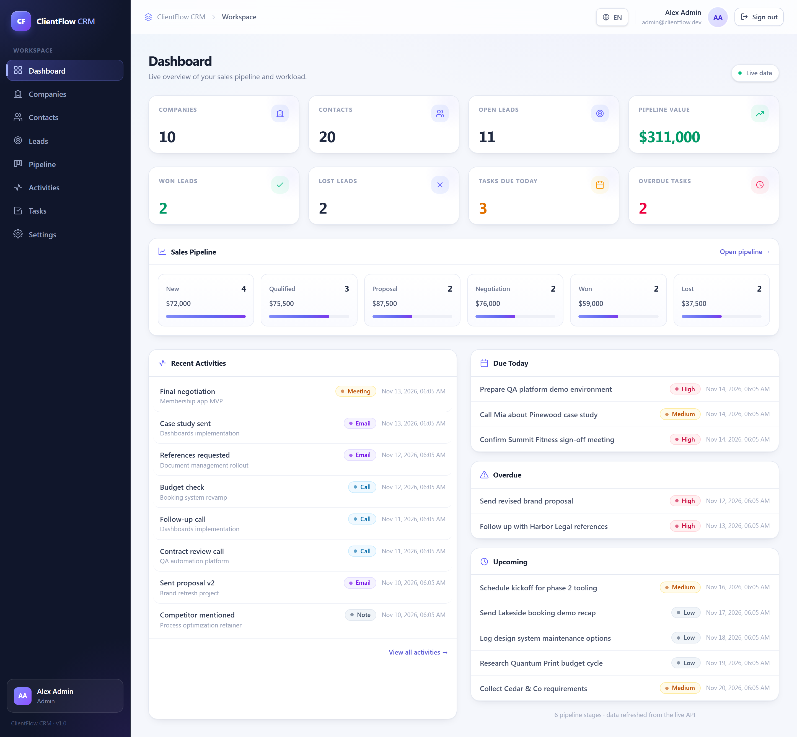
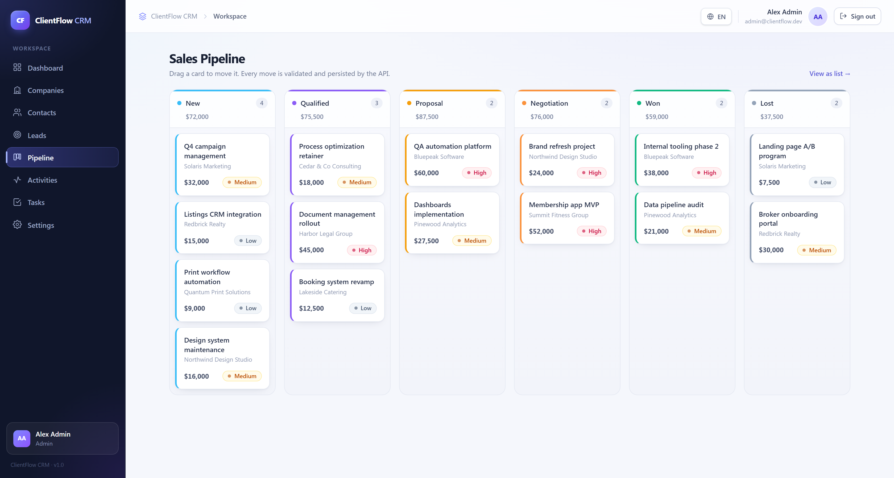
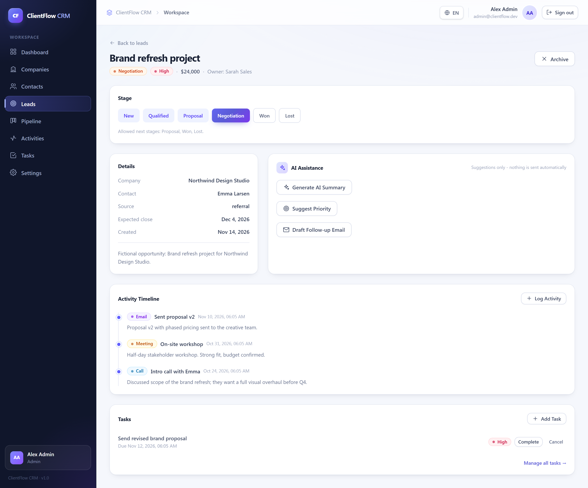

# ClientFlow CRM

A small business CRM with AI-assisted sales workflows: companies, contacts, leads,
a guarded sales pipeline, activity history, tasks, CSV import/export, an audit trail,
and an AI assistant that works fully offline. The interface ships in English and
Simplified Chinese.

**English** · [简体中文](README.zh-CN.md)



## Overview

ClientFlow CRM is built as a *small but complete* product rather than a mock-up: a real
relational database, real JWT authentication, a layered REST API, server-side business
rules, and AI features that run on a deterministic mock provider with no API key.
`docker compose up --build` is all a reviewer needs to see a working CRM with realistic
fictional data.

- **A pipeline with guardrails.** Leads move through
  `New → Qualified → Proposal → Negotiation → Won/Lost`. Illegal jumps (for example
  `New → Won`) are rejected by the backend, `Won` is terminal, and `Lost` can be
  reopened. The Kanban board validates and persists every drag through the API.
- **AI that is advisory only.** Lead summaries, priority suggestions and follow-up
  drafts are generated on request. Nothing is ever sent automatically: a draft must be
  explicitly accepted and can only be logged as a CRM activity.
- **Bilingual by design.** Every screen is translated into English and Simplified
  Chinese, switchable from the header. The choice is persisted per browser and can be
  deep-linked with `?lang=zh`.
- **Auditable by design.** Logins, entity changes, stage transitions, AI calls and
  imports are written to an admin-visible audit log — without secrets.

## Screenshots

**Sales pipeline** — drag and drop, validated and persisted server-side:



**Lead detail** — guarded stage workflow, activity timeline and the advisory AI panel:



All screenshots come from the running application with the seeded demo dataset and the
offline mock AI provider.

## Features

- Dashboard with live aggregates (companies, contacts, open/won/lost leads, pipeline
  value, tasks due today and overdue) plus a six-stage pipeline overview
- Companies, contacts and leads with search, filtering, sorting and pagination
- Kanban pipeline with drag & drop (server-validated, persisted)
- Activity history (call / email / meeting / note) with a chronological timeline
- Tasks with due dates, statuses (open / completed / cancelled) and priorities
- CSV import (companies, contacts) with duplicate detection and per-row error reporting;
  CSV export (leads, companies, contacts, tasks) hardened against formula injection
- Authentication with JWT and bcrypt-hashed passwords; `admin` and `member` roles
- Team management and an audit log (admin only)
- English / Simplified Chinese UI with a runtime language switch
- REST API with OpenAPI documentation at `/docs`
- 133 backend (pytest) and 20 frontend (Vitest + Testing Library) tests
- Docker Compose stack and a GitHub Actions pipeline

## Tech stack

| Layer | Choice |
| --- | --- |
| Backend | Python 3.13, FastAPI, SQLAlchemy 2.x, Alembic, Pydantic v2 |
| Auth | JWT (PyJWT, HS256), bcrypt password hashing |
| AI | `httpx` against the OpenAI Chat Completions API; deterministic offline mock provider |
| Database | PostgreSQL 16 in Docker Compose; SQLite for quick local runs and the test suite |
| Frontend | React 18, TypeScript, Vite, Tailwind CSS 4, React Router 6, TanStack Query 5, React Hook Form 7 |
| Testing | pytest (backend), Vitest + React Testing Library (frontend) |
| Quality | ruff, ESLint 9, `tsc`, GitHub Actions CI, gitleaks |

## Quick start

Requirements: Docker with Compose, **or** Python 3.12+ and Node.js 20+ for local
development. No OpenAI API key is needed — the mock provider works fully offline.

```bash
git clone <your-repo-url> clientflow-crm
cd clientflow-crm
docker compose up --build
```

Then open:

| Service | URL |
| --- | --- |
| Application | http://localhost:3000 |
| API health | http://localhost:8000/api/health |
| API docs (Swagger) | http://localhost:8000/docs |

The database is migrated automatically on startup and seeded with fictional demo data
(3 users, 10 companies, 20 contacts, 15 leads, 30 activities, 15 tasks).

### Docker services

| Service | Image / build | Port | Notes |
| --- | --- | --- | --- |
| `db` | `postgres:16-alpine` | internal | persistent `pgdata` volume, health check |
| `backend` | `./backend` (`python:3.13-slim`) | 8000 | runs `alembic upgrade head`, optional demo seed, then uvicorn; non-root user; health check |
| `frontend` | `./frontend` (Node build → `nginx-unprivileged`) | 3000 | serves the SPA and proxies `/api` to the backend |

Secrets (`SECRET_KEY`, `OPENAI_API_KEY`, `POSTGRES_PASSWORD`) are injected at runtime
through environment variables and never baked into images. Copy [`.env.example`](.env.example)
to `.env` to override the demo defaults.

```bash
# Use the real OpenAI integration (requires your own key):
LLM_PROVIDER=openai OPENAI_API_KEY=sk-... docker compose up
```

### Local development

Backend:

```bash
cd backend
python -m venv .venv
.venv/Scripts/pip install -e ".[dev]"        # Windows
# .venv/bin/pip install -e ".[dev]"          # macOS / Linux

# Quick run with SQLite (no infrastructure required):
DATABASE_URL=sqlite:///./clientflow.local.db SEED_DEMO_DATA=true \
  python -m uvicorn app.main:app --reload
```

Frontend:

```bash
cd frontend
npm install
npm run dev          # http://localhost:5173, proxies /api to localhost:8000
```

For PostgreSQL, point `DATABASE_URL` at your instance, run `alembic upgrade head`, then
start uvicorn.

## Demo account

| User | Password | Role |
| --- | --- | --- |
| `admin@clientflow.dev` | `Admin123!` | admin |
| `sarah@clientflow.dev` | `Member123!` | member |
| `mike@clientflow.dev` | `Member123!` | member |

These are **demo-only** credentials for the fictional seeded dataset — do not reuse them
anywhere real. There is no self-registration; admins create users in **Settings → Team**.

### Five-minute walkthrough (works entirely on the mock AI provider)

1. Sign in as `admin@clientflow.dev`
2. **Dashboard** — live aggregates from the database
3. **Companies → New Company** — create one
4. **Contacts → New Contact** — attach it to the company
5. **Leads → New Lead** — link company and contact
6. **Pipeline** — drag the lead from *New* to *Qualified* (persisted through the API)
7. Open the lead → **Log Activity** (call / email / meeting / note)
8. **Add Task** with a due date
9. **Generate AI Summary** / **Suggest Priority** → *Apply to lead*
10. **Draft Follow-up Email** → **Use Draft** → edit → *Log as Email Activity*
11. Back to **Dashboard** — the numbers have updated
12. **Settings → Audit Log** — every step above is recorded
13. Toggle **EN / 中** in the header — the whole UI switches language

## Configuration

Environment variables (see `backend/.env.example` and `.env.example`):

| Variable | Default | Purpose |
| --- | --- | --- |
| `DATABASE_URL` | `sqlite:///./clientflow.local.db` | SQLAlchemy URL (Compose uses PostgreSQL) |
| `ENVIRONMENT` | `development` | `development`, `demo` or `production` |
| `SECRET_KEY` | dev-only value | JWT signing secret — **must be overridden in production** |
| `ACCESS_TOKEN_EXPIRE_MINUTES` | `720` | JWT lifetime |
| `CORS_ORIGINS` | `http://localhost:5173` | Comma-separated allowed origins |
| `LLM_PROVIDER` | `mock` | `mock` or `openai` |
| `OPENAI_API_KEY` | empty | Required only for `openai` |
| `OPENAI_MODEL` | `gpt-4o-mini` | Chat model used by the OpenAI provider |
| `SEED_DEMO_DATA` | `false` | Seed the fictional demo dataset on startup |

**Startup guards:** with `ENVIRONMENT=production` the application refuses to boot using
the built-in development secret, with `SEED_DEMO_DATA=true`, with a wildcard
`CORS_ORIGINS`, or with an unsupported `JWT_ALGORITHM`.

## REST API

Interactive documentation lives at `/docs`. Main groups:

- `POST /api/auth/login`, `GET /api/auth/me`, `POST /api/auth/change-password`
- `GET|POST /api/users`, `PATCH /api/users/{id}` *(admin)*
- `GET /api/dashboard`
- `GET|POST /api/companies`, `GET|PATCH /api/companies/{id}`, `POST .../archive|unarchive`
- `GET|POST /api/contacts`, `GET|PATCH /api/contacts/{id}`, `POST .../archive|unarchive`
- `GET|POST /api/leads`, `GET|PATCH /api/leads/{id}`, `PATCH /api/leads/{id}/stage`, `POST .../archive|unarchive`
- `GET|POST /api/activities`, `PATCH /api/activities/{id}`
- `GET|POST /api/tasks`, `PATCH /api/tasks/{id}`
- `POST /api/ai/leads/{id}/summary|priority|follow-up`
- `POST /api/import/companies`, `POST /api/import/contacts`
- `GET /api/export/{leads|companies|contacts|tasks}`
- `GET /api/audit-logs` *(admin)*
- `GET /api/health`

Every endpoint except login and health requires a bearer token; role checks are enforced
server-side. List endpoints accept `page`, `page_size` (max 100), `search`, whitelisted
`sort_by` / `order` and entity-specific filters. Validation errors share one response
shape: `{ "detail": "<message>", "errors": [...] }`.

## AI features

| Endpoint | Input (CRM data) | Validated output |
| --- | --- | --- |
| `POST /api/ai/leads/{id}/summary` | lead, company, contact, recent activities | `{ summary }` |
| `POST /api/ai/leads/{id}/priority` | same | `{ priority: low\|medium\|high, reasoning }` |
| `POST /api/ai/leads/{id}/follow-up` | same | `{ subject, body }` |

- The default `mock` provider is deterministic (same lead → same output), so demos and
  tests are reproducible without network access.
- The `openai` provider calls the real Chat Completions API, uses strict JSON-mode
  structured output validated by Pydantic, bounded retries (network errors, 5xx and 429
  only — never on auth failures), timeouts and `Retry-After` handling. Invalid output
  returns a clean `502` and never modifies CRM data.
- Customer-controlled text is treated as untrusted: it travels inside explicitly
  delimited blocks in the user message, never in the system prompt, which keeps prompt
  injection isolated.
- Every AI call is audited with its provider name; token usage is recorded when the
  provider reports it and stays `null` otherwise (never estimated).

## Import / export

**Import** (companies, contacts): UTF-8 CSV with headers
`name,website,industry,phone,email,address,notes` or
`first_name,last_name,email,company,phone,job_title,notes`. Each row is validated
individually; duplicates are skipped; invalid rows are reported with their row numbers
and never fail the whole file. Contact imports require the company to exist first.
Files are capped at 5,000 rows and 5 MB.

**Export** (leads, companies, contacts, tasks): generated from live data, written as
UTF-8 with a BOM so Excel opens non-ASCII content correctly. Cells that would start a
formula (including values with leading whitespace) are neutralized with a leading
apostrophe, while numeric columns stay numeric.

## Internationalization

The UI is fully bilingual. English strings are the source keys, and
`frontend/src/i18n/zh.ts` maps them to Simplified Chinese; `frontend/src/i18n/index.tsx`
provides the `I18nProvider`, `useI18n()` and a `t(key, vars)` helper with placeholder
interpolation. The active language is stored in `localStorage` and can be forced with
`?lang=en` or `?lang=zh`. Dates follow the active locale, while monetary amounts keep
their own currency formatting.

## Testing

```bash
# Backend (SQLite by default; set TEST_DATABASE_URL for PostgreSQL)
cd backend
pytest                       # 133 tests
ruff check src tests

# Frontend
cd frontend
npm test                     # 20 tests
npm run typecheck && npm run lint && npm run build
```

Backend tests are API-level integration tests (HTTP → FastAPI → service → repository →
database) covering authentication and authorization, every CRUD area, stage-transition
guardrails, pagination/filtering/sorting, CSV import/export, dashboard aggregates, audit
logging, configuration guards and AI. AI tests never touch the network: OpenAI provider
behaviour (structured output, retries, rate limits, auth errors, timeouts,
prompt-injection isolation) is simulated with `httpx.MockTransport`.

`.github/workflows/ci.yml` runs four jobs on every push and pull request to `main`:

| Job | What it does |
| --- | --- |
| Backend | ruff, Alembic `upgrade` / `check` / `downgrade` against a real PostgreSQL 16 service, then pytest |
| Frontend | ESLint, `tsc`, Vitest and a production build |
| Docker | Builds both images to catch broken build contexts and Dockerfiles |
| Secret scan | gitleaks over the full git history |

## Security

- Passwords are bcrypt hashes; login failures return a generic `401` (no user
  enumeration) and deactivated users are rejected on every request. Password length is
  validated in UTF-8 bytes so bcrypt never errors.
- JWT bearer tokens; no cookies, so classical CSRF does not apply. Tokens are kept in
  `localStorage` — a documented trade-off for this scope, mitigated by rotating
  `SECRET_KEY` and short lifetimes.
- Authorization is enforced in backend dependencies, never only in the UI; admins cannot
  deactivate their own account.
- SQL injection is prevented by SQLAlchemy bound parameters and escaped `LIKE` terms.
- XSS: React output escaping, no `dangerouslySetInnerHTML`, and AI-generated text is
  rendered as plain text.
- CSV injection is neutralized on export; uploads are limited by extension, encoding,
  row count and size.
- Audit metadata never contains passwords, tokens or API keys.

## Project structure

```
├── backend/
│   ├── alembic/                  # migrations
│   ├── src/app/
│   │   ├── api/                  # FastAPI routers
│   │   ├── core/                 # config, security, dependencies, errors
│   │   ├── db/                   # engine, session, declarative base
│   │   ├── models/               # SQLAlchemy ORM models and enums
│   │   ├── schemas/              # Pydantic request/response models
│   │   ├── repositories/         # database queries
│   │   ├── services/             # business rules and audit logging
│   │   ├── providers/            # LLMProvider: mock and OpenAI (+ prompts)
│   │   ├── seeds/                # fictional demo dataset
│   │   └── main.py               # app factory, error handlers, CORS
│   ├── tests/                    # pytest suite
│   └── alembic.ini, Dockerfile, entrypoint.sh
├── frontend/
│   ├── src/
│   │   ├── api/                  # typed fetch client and endpoint modules
│   │   ├── components/           # UI primitives, forms, pipeline board, icons
│   │   ├── context/              # auth context
│   │   ├── i18n/                 # English keys, Chinese dictionary, provider
│   │   ├── layouts/, pages/      # app shell and routes
│   │   └── test/                 # Vitest + Testing Library tests
│   ├── Dockerfile, nginx.conf
├── docs/screenshots/
├── .github/workflows/ci.yml
└── docker-compose.yml
```

## Limitations

Honest scope boundaries:

- Single-organization deployment; no multi-tenancy, billing or subscription management
- "Today" boundaries for task buckets are computed on the UTC day
- No email sending, notifications or calendar sync — drafts are only logged as activities
- The Kanban board loads up to 100 leads
- JWT revocation is implicit: deactivation is checked per request, there is no token
  blacklist
- Archiving a company does not cascade to its contacts and leads; archived records stay
  readable by ID so they can be restored
- SQLite is supported for quick local runs and tests; PostgreSQL is the primary database
  used by Docker Compose and CI

## License

MIT — see [LICENSE](LICENSE).
