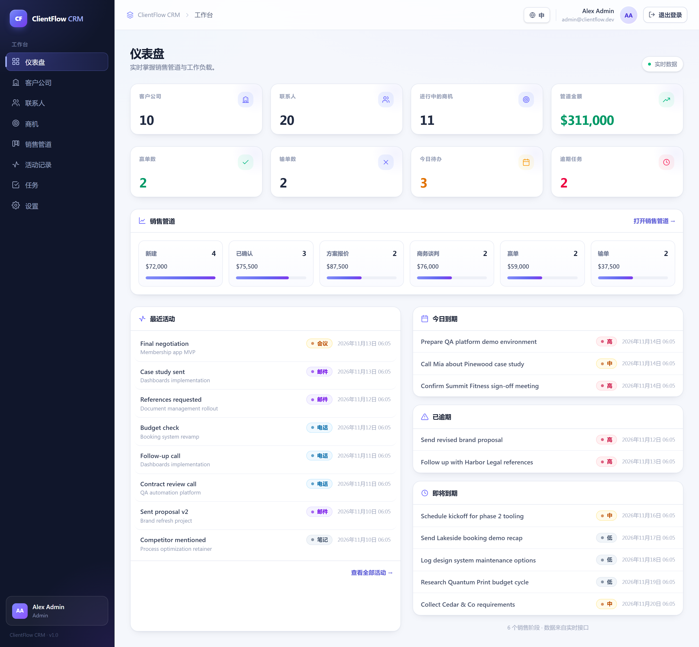
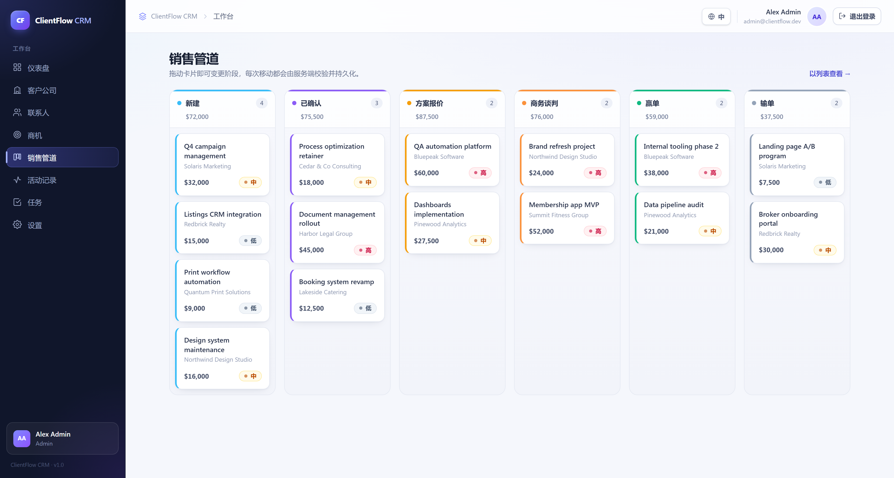
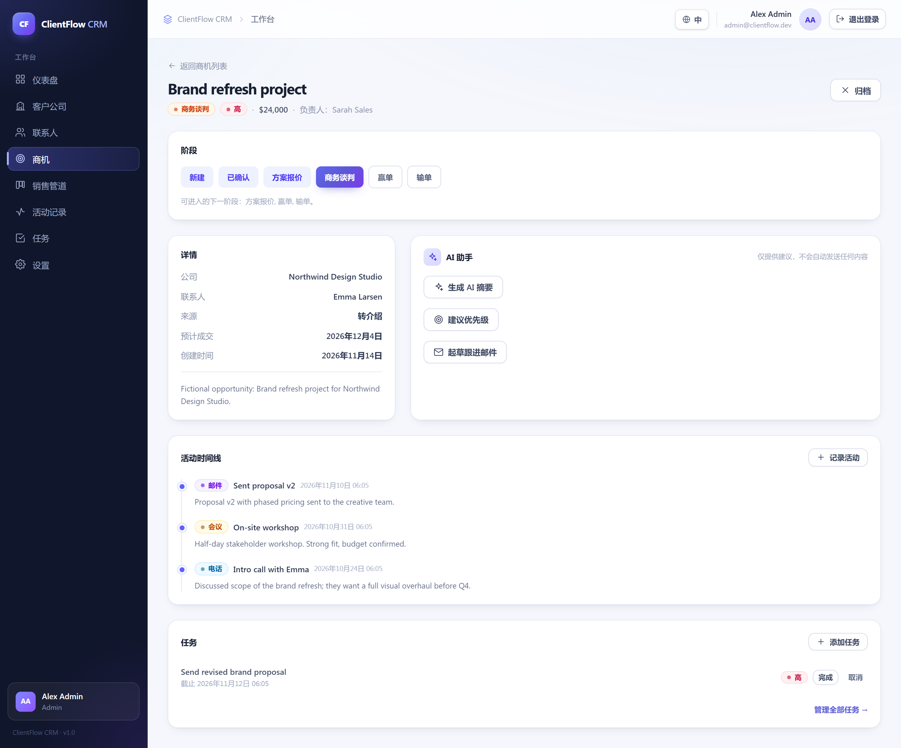

# ClientFlow CRM

面向小团队的客户关系管理（CRM）系统，内置 AI 辅助销售流程：客户公司、联系人、商机、
带业务规则的销售管道、活动历史、任务、CSV 导入导出、审计日志，以及完全离线可用的
AI 助手。界面支持简体中文与英文双语。

[English](README.md) · **简体中文**



## 项目简介

ClientFlow CRM 追求"小而完整"，而不是一个演示外壳：真实的关系型数据库、真实的 JWT
认证、分层清晰的 REST API、服务端业务规则，以及无需任何 API Key 即可离线运行的 AI
能力（确定性 Mock Provider）。执行 `docker compose up --build`，评审者就能看到一个
带真实示例数据的完整 CRM。

- **带规则的销售管道。** 商机按 `新建 → 已确认 → 方案报价 → 商务谈判 → 赢单/输单`
  流转。非法跳转（例如 `新建 → 赢单`）会被后端直接拒绝，`赢单` 为终态，`输单`
  可以重新开启。看板上的每一次拖动都由 API 校验并持久化。
- **AI 只提供建议。** 商机摘要、优先级建议和跟进邮件草稿都需手动触发，系统绝不会
  自动发送任何内容：草稿必须显式采用，且只能作为 CRM 活动记录保存。
- **原生双语。** 所有页面均提供中英文，可在顶栏一键切换；语言选择会按浏览器持久化，
  也支持通过 `?lang=zh` 直接链接到中文界面。
- **可审计。** 登录、实体变更、阶段流转、AI 调用和导入操作都会写入管理员可见的
  审计日志，且不包含任何密钥。

## 界面截图

**销售管道** —— 拖放变更阶段，由服务端校验并持久化：



**商机详情** —— 受控的阶段流转、活动时间线与 AI 建议面板：



以上截图均来自真实运行的应用（使用预置示例数据与离线 Mock AI Provider）。

## 功能清单

- 仪表盘实时聚合（公司数、联系人数、进行中/赢单/输单商机、管道金额、今日与逾期任务）
  以及六阶段管道概览
- 公司、联系人、商机支持搜索、筛选、排序与分页
- 支持拖拽的看板式销售管道（服务端校验、持久化）
- 活动历史（电话 / 邮件 / 会议 / 笔记）与时间线视图
- 任务管理，支持截止时间、状态（待办 / 已完成 / 已取消）与优先级
- CSV 导入（公司、联系人）：重复检测、逐行错误报告；CSV 导出（商机、公司、联系人、
  任务）具备公式注入防护
- JWT 认证与 bcrypt 密码哈希；`admin` / `member` 两种角色
- 团队管理与审计日志（仅管理员）
- 中英文双语界面，运行时切换
- REST API，Swagger 文档位于 `/docs`
- 133 个后端测试（pytest）与 20 个前端测试（Vitest + Testing Library）
- Docker Compose 一键启动，GitHub Actions 持续集成

## 技术栈

| 层次 | 选型 |
| --- | --- |
| 后端 | Python 3.13、FastAPI、SQLAlchemy 2.x、Alembic、Pydantic v2 |
| 认证 | JWT（PyJWT，HS256）、bcrypt 密码哈希 |
| AI | 通过 `httpx` 调用 OpenAI Chat Completions；确定性离线 Mock Provider |
| 数据库 | Docker Compose 使用 PostgreSQL 16；SQLite 用于本地快速运行与测试 |
| 前端 | React 18、TypeScript、Vite、Tailwind CSS 4、React Router 6、TanStack Query 5、React Hook Form 7 |
| 测试 | pytest（后端）、Vitest + React Testing Library（前端） |
| 质量保障 | ruff、ESLint 9、`tsc`、GitHub Actions CI、gitleaks |

## 快速开始

环境要求：安装 Docker 与 Compose，**或者** Python 3.12+ 与 Node.js 20+ 进行本地开发。
无需 OpenAI API Key——Mock Provider 完全离线可用。

```bash
git clone <your-repo-url> clientflow-crm
cd clientflow-crm
docker compose up --build
```

启动后访问：

| 服务 | 地址 |
| --- | --- |
| 应用界面 | http://localhost:3000 |
| API 健康检查 | http://localhost:8000/api/health |
| API 文档（Swagger） | http://localhost:8000/docs |

数据库会在启动时自动迁移，并写入虚构的示例数据（3 个用户、10 家公司、20 个联系人、
15 个商机、30 条活动、15 个任务）。

### Docker 服务

| 服务 | 镜像 / 构建 | 端口 | 说明 |
| --- | --- | --- | --- |
| `db` | `postgres:16-alpine` | 内部 | 持久化卷 `pgdata`，含健康检查 |
| `backend` | `./backend`（`python:3.13-slim`） | 8000 | 依次执行 `alembic upgrade head`、可选的示例数据、uvicorn；非 root 用户；含健康检查 |
| `frontend` | `./frontend`（Node 构建 → `nginx-unprivileged`） | 3000 | 提供 SPA 静态资源，并将 `/api` 反向代理到后端 |

`SECRET_KEY`、`OPENAI_API_KEY`、`POSTGRES_PASSWORD` 等敏感信息通过环境变量在运行时注入，
不会被打进镜像。如需覆盖演示默认值，可将 [`.env.example`](.env.example) 复制为 `.env`。

```bash
# 使用真实 OpenAI 接口（需要自备 Key）：
LLM_PROVIDER=openai OPENAI_API_KEY=sk-... docker compose up
```

### 本地开发

后端：

```bash
cd backend
python -m venv .venv
.venv/Scripts/pip install -e ".[dev]"        # Windows
# .venv/bin/pip install -e ".[dev]"          # macOS / Linux

# 使用 SQLite 快速运行（无需任何基础设施）：
DATABASE_URL=sqlite:///./clientflow.local.db SEED_DEMO_DATA=true \
  python -m uvicorn app.main:app --reload
```

前端：

```bash
cd frontend
npm install
npm run dev          # http://localhost:5173，并将 /api 代理到 localhost:8000
```

使用 PostgreSQL 时，将 `DATABASE_URL` 指向你的实例，执行 `alembic upgrade head`，
再启动 uvicorn 即可。

## 演示账号

| 用户 | 密码 | 角色 |
| --- | --- | --- |
| `admin@clientflow.dev` | `Admin123!` | 管理员 |
| `sarah@clientflow.dev` | `Member123!` | 成员 |
| `mike@clientflow.dev` | `Member123!` | 成员 |

以上账号**仅用于演示**，对应虚构的示例数据，请勿在任何真实环境中复用。系统不开放
自助注册，由管理员在 **设置 → 团队** 中创建成员。

### 五分钟体验路径（全部可在 Mock AI 下完成）

1. 使用 `admin@clientflow.dev` 登录
2. **仪表盘** —— 查看来自数据库的实时聚合数据
3. **客户公司 → 新建公司** —— 创建一家公司
4. **联系人 → 新建联系人** —— 挂到该公司下
5. **商机 → 新建商机** —— 关联公司与联系人
6. **销售管道** —— 把商机从 *新建* 拖到 *已确认*（通过 API 持久化）
7. 打开商机 → **记录活动**（电话 / 邮件 / 会议 / 笔记）
8. **添加任务** 并设置截止时间
9. **生成 AI 摘要** / **建议优先级** → *应用到商机*
10. **起草跟进邮件** → **使用草稿** → 编辑 → *记录为邮件活动*
11. 返回 **仪表盘** —— 数据已更新
12. **设置 → 审计日志** —— 上述每一步都有记录
13. 点击顶栏 **EN / 中** —— 整个界面切换语言

## 配置项

环境变量（参见 `backend/.env.example` 与 `.env.example`）：

| 变量 | 默认值 | 说明 |
| --- | --- | --- |
| `DATABASE_URL` | `sqlite:///./clientflow.local.db` | SQLAlchemy 连接串（Compose 使用 PostgreSQL） |
| `ENVIRONMENT` | `development` | `development`、`demo` 或 `production` |
| `SECRET_KEY` | 仅开发用默认值 | JWT 签名密钥——**生产环境必须覆盖** |
| `ACCESS_TOKEN_EXPIRE_MINUTES` | `720` | JWT 有效期（分钟） |
| `CORS_ORIGINS` | `http://localhost:5173` | 允许的跨域来源，逗号分隔 |
| `LLM_PROVIDER` | `mock` | `mock` 或 `openai` |
| `OPENAI_API_KEY` | 空 | 仅 `openai` 模式需要 |
| `OPENAI_MODEL` | `gpt-4o-mini` | OpenAI Provider 使用的模型 |
| `SEED_DEMO_DATA` | `false` | 启动时写入虚构示例数据 |

**启动守卫：** 当 `ENVIRONMENT=production` 时，若仍使用内置开发密钥、开启
`SEED_DEMO_DATA=true`、`CORS_ORIGINS` 含通配符，或 `JWT_ALGORITHM` 不受支持，
应用会拒绝启动。

## REST API

交互式文档位于 `/docs`，主要分组如下：

- `POST /api/auth/login`、`GET /api/auth/me`、`POST /api/auth/change-password`
- `GET|POST /api/users`、`PATCH /api/users/{id}` *（管理员）*
- `GET /api/dashboard`
- `GET|POST /api/companies`、`GET|PATCH /api/companies/{id}`、`POST .../archive|unarchive`
- `GET|POST /api/contacts`、`GET|PATCH /api/contacts/{id}`、`POST .../archive|unarchive`
- `GET|POST /api/leads`、`GET|PATCH /api/leads/{id}`、`PATCH /api/leads/{id}/stage`、`POST .../archive|unarchive`
- `GET|POST /api/activities`、`PATCH /api/activities/{id}`
- `GET|POST /api/tasks`、`PATCH /api/tasks/{id}`
- `POST /api/ai/leads/{id}/summary|priority|follow-up`
- `POST /api/import/companies`、`POST /api/import/contacts`
- `GET /api/export/{leads|companies|contacts|tasks}`
- `GET /api/audit-logs` *（管理员）*
- `GET /api/health`

除登录与健康检查外，所有接口都需要 Bearer Token；角色校验在服务端强制执行。列表接口
支持 `page`、`page_size`（最大 100）、`search`、白名单内的 `sort_by` / `order`
以及各实体特有的筛选项。校验错误统一返回 `{ "detail": "<message>", "errors": [...] }`。

## AI 能力

| 接口 | 输入（CRM 数据） | 经校验的输出 |
| --- | --- | --- |
| `POST /api/ai/leads/{id}/summary` | 商机、公司、联系人、近期活动 | `{ summary }` |
| `POST /api/ai/leads/{id}/priority` | 同上 | `{ priority: low\|medium\|high, reasoning }` |
| `POST /api/ai/leads/{id}/follow-up` | 同上 | `{ subject, body }` |

- 默认 `mock` Provider 是确定性的（同一商机得到同一输出），因此演示与测试在无网络
  环境下也可复现。
- `openai` Provider 调用真实的 Chat Completions 接口：使用严格 JSON 模式的结构化输出
  并由 Pydantic 校验，重试有次数上限（仅针对网络错误、5xx 与 429，认证失败绝不重试），
  支持超时与 `Retry-After`。输出不合法时返回干净的 `502`，绝不修改 CRM 数据。
- 客户可控文本被视为不可信内容：只放在用户消息中明确分隔的数据块里，永远不进入系统
  提示词，从而隔离提示词注入。
- 每次 AI 调用都会记录审计（含 Provider 名称）；Provider 返回 token 用量时如实记录，
  否则保持 `null`，从不估算。

## 导入 / 导出

**导入**（公司、联系人）：UTF-8 编码 CSV，表头为
`name,website,industry,phone,email,address,notes` 或
`first_name,last_name,email,company,phone,job_title,notes`。逐行校验，重复数据自动跳过，
错误行会带行号回报，单行错误不会导致整个文件失败。导入联系人前需先存在对应公司。
文件上限为 5,000 行、5 MB。

**导出**（商机、公司、联系人、任务）：基于实时数据生成，写出 UTF-8 BOM，确保 Excel
打开非 ASCII 内容不乱码。可能被识别为公式的单元格（含前导空白的情况）会加前导单引号
中和，而数值列保持数值类型。

## 国际化

界面完整支持中英双语。英文原文即字典键，`frontend/src/i18n/zh.ts` 提供简体中文映射；
`frontend/src/i18n/index.tsx` 提供 `I18nProvider`、`useI18n()` 与支持占位符插值的
`t(key, vars)`。当前语言保存在 `localStorage`，也可通过 `?lang=en` 或 `?lang=zh`
强制指定。日期随当前语言格式化，金额则保持其币种格式。

## 测试

```bash
# 后端（默认 SQLite；设置 TEST_DATABASE_URL 可跑 PostgreSQL）
cd backend
pytest                       # 133 个测试
ruff check src tests

# 前端
cd frontend
npm test                     # 20 个测试
npm run typecheck && npm run lint && npm run build
```

后端测试是 API 级集成测试（HTTP → FastAPI → Service → Repository → 数据库），覆盖认证
与授权、各模块 CRUD、阶段流转守卫、分页/筛选/排序、CSV 导入导出、仪表盘聚合、审计
日志、配置守卫与 AI。AI 测试不访问网络：OpenAI Provider 的行为（结构化输出、重试、
限流、认证错误、超时、提示词注入隔离）通过 `httpx.MockTransport` 模拟验证。

`.github/workflows/ci.yml` 在每次推送与 PR 到 `main` 时运行四个任务：

| 任务 | 内容 |
| --- | --- |
| Backend | ruff、针对真实 PostgreSQL 16 执行 Alembic `upgrade` / `check` / `downgrade`，然后 pytest |
| Frontend | ESLint、`tsc`、Vitest 与生产构建 |
| Docker | 构建前后端镜像，及时发现构建上下文与 Dockerfile 问题 |
| Secret scan | 对完整 git 历史运行 gitleaks |

## Security

- Passwords are bcrypt hashes; login failures return a generic `401` (no user
  enumeration) and deactivated users are rejected on every request. Password length is
  validated in UTF-8 bytes so bcrypt never errors.
- JWT bearer tokens; no cookies, so classical CSRF does not apply. Tokens are kept in
  `localStorage` — a documented trade-off for this scope, mitigated by rotating
  `SECRET_KEY` and short lifetimes.
- Authorization is enforced in backend dependencies, never only in the UI; admins cannot
  deactivate their own account.
- SQL injection is prevented by SQLAlchemy bound parameters and escaped `LIKE` terms.
- XSS: React output escaping, no `dangerouslySetInnerHTML`, and AI-generated text is
  rendered as plain text.
- CSV injection is neutralized on export; uploads are limited by extension, encoding,
  row count and size.
- Audit metadata never contains passwords, tokens or API keys.

## 项目结构

```
├── backend/
│   ├── alembic/                  # 数据库迁移
│   ├── src/app/
│   │   ├── api/                  # FastAPI 路由
│   │   ├── core/                 # 配置、安全、依赖、错误
│   │   ├── db/                   # 引擎、会话、声明式基类
│   │   ├── models/               # SQLAlchemy ORM 模型与枚举
│   │   ├── schemas/              # Pydantic 请求/响应模型
│   │   ├── repositories/         # 数据查询
│   │   ├── services/             # 业务规则与审计
│   │   ├── providers/            # LLMProvider：Mock 与 OpenAI（含提示词）
│   │   ├── seeds/                # 虚构示例数据
│   │   └── main.py               # 应用工厂、异常处理、CORS
│   ├── tests/                    # pytest 测试
│   └── alembic.ini、Dockerfile、entrypoint.sh
├── frontend/
│   ├── src/
│   │   ├── api/                  # 带类型的请求客户端与接口模块
│   │   ├── components/           # UI 基础组件、表单、看板、图标
│   │   ├── context/              # 认证上下文
│   │   ├── i18n/                 # 英文键、中文词典、Provider
│   │   ├── layouts/、pages/      # 应用外壳与页面
│   │   └── test/                 # Vitest + Testing Library 测试
│   ├── Dockerfile、nginx.conf
├── docs/screenshots/
├── .github/workflows/ci.yml
└── docker-compose.yml
```

## 已知边界

诚实的范围说明：

- 单组织部署；不支持多租户、计费或订阅管理
- 任务"今日"边界按 UTC 日期计算
- 不发送邮件、不做通知与日历同步——草稿只作为活动记录保存
- 看板最多加载 100 个商机
- JWT 撤销是隐式的：每次请求都检查用户是否被停用，没有 Token 黑名单
- 归档公司不会级联归档其联系人与商机；归档记录仍可按 ID 读取以便恢复
- SQLite 适用于本地快速运行与测试；Docker Compose 与 CI 使用 PostgreSQL

## License

MIT — see [LICENSE](LICENSE).
